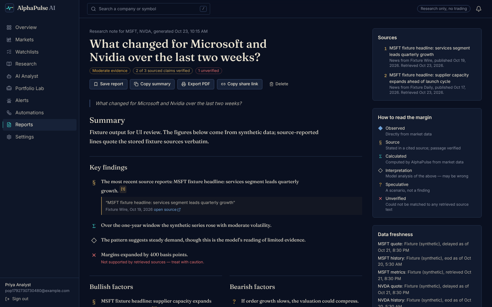
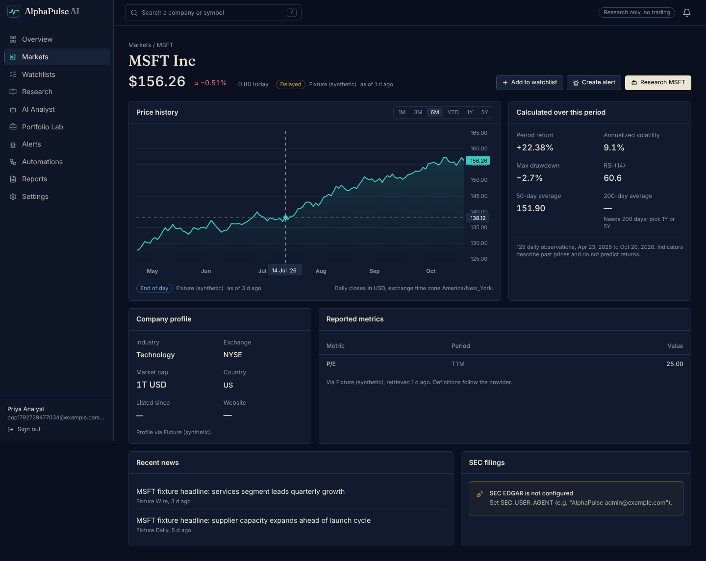

# AlphaPulse AI

**From market signals to investment intelligence.**

AlphaPulse AI is an investment research and workflow-automation platform. It collects market data, company news and SEC
filings for the companies you follow, computes deterministic analytics, and writes research notes in which every
source-reported claim links to the exact passage that supports it. When a passage can't be found in the retrieved source,
the claim is marked **unverified** instead of being presented as fact.

> Research and decision support only. AlphaPulse does not place trades, connect to brokerages, compute taxes, or give
> individualized financial advice. Market data may be delayed. Past performance does not predict future results.



<sub>Screenshots in this README were captured against the local **fixture** stack (synthetic data, providers labelled
"Fixture (synthetic)"), not live market data.</sub>

## Features

| Area | What it does |
|---|---|
| **Overview** | Configurable dashboard: index-tracking ETFs, watchlists, headlines, recent research, active alerts, automation status, data and pipeline health. |
| **Markets** | Symbol search, company pages (delayed quote, daily history with range selection, profile, reported metrics *with their periods*, news, SEC filings), 2–5 company comparison with rebased returns, volatility, drawdown and a correlation matrix. |
| **Watchlists** | Multiple lists, private notes per symbol, delayed quotes and one-month sparklines. |
| **Research** | Source library (news, SEC filings, RSS items, uploads) with provenance and text-extraction status; PDF/TXT/MD upload; RSS/Atom import through an SSRF guard; run history. |
| **AI Analyst** | Question → validated symbols → market data → sources (deduped, ranked) → deterministic metrics → structured LLM output (JSON Schema) → schema validation with one repair attempt → citation verification → persisted report. Without an LLM key it produces an honest data-only report. |
| **Portfolio Lab** | Hypothetical holdings: value, cost basis, unrealized P&L, allocation, concentration (top weight, HHI), historical value, drawdown, benchmark difference, correlations. Unpriced or currency-mismatched positions are reported, never guessed. |
| **Alerts** | Price above/below and daily % move; cooldown plus a unique idempotency key prevent duplicate events; in-app, email (Resend) and Slack/Discord delivery with per-channel status that only says *delivered* after the provider accepted it. |
| **Automations** | Daily brief (US trading days, NYSE holiday table), watchlist monitor, weekly digest, data-source health. Idempotent per schedule window, timeouts, bounded retries, execution history, manual rerun, enable/disable, signed n8n webhook. |
| **Reports** | Full-text search, filters, save, copy summary, print-to-PDF, revocable share links, side-by-side comparison across dates. |
| **Settings** | Profile, time zone, notification preferences and webhook, password change, account deletion; admin user management. |



## Architecture

```
                 ┌──────────────────────────────── Render ───────────────────────────────┐
  Browser ──────▶│ alphapulse-web (Next.js 16, App Router)                                │
  (first-party   │   /              landing                                               │
   cookie)       │   /app/*         workspace                                             │
                 │   /api/v1/* ──rewrite──▶ alphapulse-api (Express 5, TypeScript)        │
                 │                              ├─ routes → services → models/providers   │
                 │                              ├─ in-process runner or BullMQ (Redis)    │
                 │                              └─ /api/v1/hooks/n8n/run (HMAC-signed) ◀──┼── n8n (optional)
                 └──────────────────────────────┬────────────────────────────────────────┘
          MongoDB Atlas ◀───────────────────────┤
          Twelve Data · Finnhub · SEC EDGAR ◀───┤   all provider keys stay server-side
          Gemini or OpenRouter (LLM) · Resend · webhooks ◀┘
```

- `packages/shared`: Zod contracts, deterministic analytics (returns, volatility, SMA/EMA, RSI, drawdown,
  correlation, benchmark), alert rules, source dedupe/ranking, citation validation, portfolio valuation.
- `apps/api`: Express API with fail-fast config, Mongoose models, provider adapters, services, OpenAPI.
- `apps/web`: Next.js UI with the "Ledger Night" design system ([docs/DESIGN_SYSTEM.md](docs/DESIGN_SYSTEM.md)).
- `services/workflows`: importable n8n workflows and setup notes.

The web app proxies `/api/v1/*` to the API so the session cookie is first-party (`*.onrender.com` is a public suffix,
so two onrender subdomains are cross-site). Details: [docs/SYSTEM_ARCHITECTURE.md](docs/SYSTEM_ARCHITECTURE.md).

## Technology

Next.js 16 · React 19 · TypeScript (strict) · Tailwind CSS 4 · TanStack Query · React Hook Form + Zod ·
Google Gemini · Lightweight Charts · Framer Motion · Radix Dialog · Lucide · Express 5 · Mongoose 9 · Argon2id · pino · helmet ·
express-rate-limit · BullMQ (optional) · node-cron · OpenAPI 3 / Swagger UI · Vitest · Testing Library · Supertest ·
mongodb-memory-server · Playwright.

## Running locally

Requirements: Node 22+, a MongoDB (Atlas, `docker compose up -d mongo`, or a local `mongod`).

```bash
npm install
cp .env.example apps/api/.env          # set MONGODB_URI at minimum
echo "API_BASE_URL=http://localhost:4000" > apps/web/.env.local
npm run build -w @alphapulse/shared
npm run dev:api                        # http://localhost:4000/api/v1/docs
npm run dev:web                        # http://localhost:3000
```

The first account you register becomes the administrator. Add provider keys to light up each area; without them the UI
shows what isn't configured and how to fix it.

**Fixture mode for UI work** (synthetic providers, never deployed):

```bash
cd apps/api && MONGODB_URI=mongodb://127.0.0.1:27017/alphapulse_fixture PORT=4000 npx tsx test/fixture-server.ts
```

## Environment variables

See [.env.example](.env.example) for the full list with notes.

| Variable | Service | Required | Purpose |
|---|---|---|---|
| `MONGODB_URI` | API | yes | MongoDB Atlas connection string |
| `SESSION_SECRET` | API | yes (prod) | ≥ 32 chars; Blueprint generates it |
| `APP_BASE_URL` | API | yes (prod) | Public web URL (CORS, CSRF origin, email links) |
| `API_BASE_URL` | Web | yes | API's public URL, server-only, read at build and start |
| `TWELVE_DATA_API_KEY` | API | optional | Quotes, history, search |
| `FINNHUB_API_KEY` | API | optional | News, profile, metrics |
| `SEC_USER_AGENT` | API | optional | Enables SEC EDGAR (`"AlphaPulse you@example.com"`) |
| `GEMINI_API_KEY`, `GEMINI_MODEL` | API | optional | AI analyst via Google Gemini (preferred when set) |
| `OPENROUTER_API_KEY`, `OPENROUTER_MODEL` | API | optional | AI analyst via OpenRouter (alternative) |
| `RESEND_API_KEY`, `EMAIL_FROM` | API | optional | Email delivery, verification, password reset |
| `N8N_WEBHOOK_SECRET`, `N8N_BASE_URL` | API | optional | Signed n8n triggers |
| `SCHEDULER_ENABLED` | API | optional | Built-in cron (needs an always-on instance) |
| `REDIS_URL` | API | optional | BullMQ queue instead of the in-process runner |

No secret uses a `NEXT_PUBLIC_` prefix; nothing secret reaches the browser bundle.

## API

Versioned REST under `/api/v1`, documented with OpenAPI: **`/api/v1/docs`** (Swagger UI) and `/api/v1/openapi.json`.
Session cookie auth; every non-GET request needs the header `X-AlphaPulse-CSRF: 1`. Errors use one envelope:
`{ "error": { "code", "message", "details?" } }`. Lists accept `page`/`pageSize`; user-owned resources owned by
someone else return `404`.

```bash
curl -c jar -H 'content-type: application/json' -H 'X-AlphaPulse-CSRF: 1' \
  -d '{"email":"a@example.com","password":"correct-horse-9"}' $API/api/v1/auth/login
curl -b jar -H 'content-type: application/json' -H 'X-AlphaPulse-CSRF: 1' \
  -d '{"question":"What changed for Microsoft this week?","symbols":["MSFT"],"task":"company_update"}' $API/api/v1/research
```

## Data sources and attribution

| Source | Used for | Limits worth knowing |
|---|---|---|
| [Twelve Data](https://twelvedata.com) | Quotes, daily history, search | Free: 800 req/day, 8/min, US listings, *internal non-display use*: public display needs a paid plan |
| [Finnhub](https://finnhub.io) | News, profiles, metrics | Free: ~60 calls/min, non-commercial |
| [SEC EDGAR](https://www.sec.gov/os/accessing-edgar-data) | Filings | ≤ 10 req/s and a descriptive User-Agent; AlphaPulse throttles to ~5/s |
| User RSS feeds and uploads | Extra sources | Untrusted input, owner-scoped |

NSE/BSE are not scraped; Indian listings work only if your market-data plan covers them. Full notes:
[docs/DATA_SOURCES.md](docs/DATA_SOURCES.md).

## n8n

Four importable workflows in [`services/workflows/n8n`](services/workflows/n8n) call a single HMAC-signed endpoint.
Setup, hosting options and verification steps: [services/workflows/README.md](services/workflows/README.md).

## Testing

```bash
npm run lint && npm run typecheck
npm test                                # shared + API (needs a mongod; CI downloads one) + web components
cd apps/web && npx playwright test      # e2e against the fixture stack (start it first)
```

| Suite | What it covers |
|---|---|
| `packages/shared` (41) | Every analytics formula against hand-computed values, alert rules, cooldown keys, dedupe, ranking, citation validation, portfolio valuation, schema rejection of operator injection |
| `apps/api` unit (36) | Config fail-fast, SSRF guard, HMAC signatures, retry policy, provider adapters, RSS/Atom parsing (no entity expansion), prompt isolation, calendar, idempotency keys |
| `apps/api` integration (45) | Auth (Argon2id, hashed sessions, CSRF, expiry, reset), watchlist/portfolio/alert/report CRUD and cross-user isolation, provider failure handling, research pipeline end to end, workflows, n8n webhook, admin, concurrency regressions |
| `apps/web` (22) | Formatting, states, forms, accessible tables, citation interaction, navigation, API client, auth form validation |
| Playwright (6) | The full journey on desktop and mobile, auth redirect, landing overflow |

External services are always mocked in tests; mocks live under `test/` and are never imported by production code.

## Deployment (Render)

[`render.yaml`](render.yaml) defines `alphapulse-api` and `alphapulse-web` (free plan, Singapore). Steps:

1. Create a MongoDB Atlas cluster; allow Render's egress (or `0.0.0.0/0` with a strong password).
2. In Render: **New → Blueprint**, select this repository.
3. Fill the `sync: false` variables: `MONGODB_URI`, `APP_BASE_URL` (web URL), `API_PUBLIC_URL` (API URL),
   `API_BASE_URL` on the web service (API URL), and any provider keys.
4. After the first deploy, redeploy **alphapulse-web** once more if you changed `API_BASE_URL` (rewrites are fixed at build time).
5. Check `https://<api>/api/v1/health`, register the first (admin) account, then run **Automations → Data source health monitor**.

Free-plan caveats: services sleep after 15 minutes idle (about one minute to wake), so use n8n for schedules or a
paid instance with `SCHEDULER_ENABLED=true`. The in-memory rate limiter and in-process job runner assume a single instance.

## Security

Argon2id password hashing; random session tokens stored only as SHA-256 hashes in HttpOnly `SameSite=Lax` cookies with
idle and absolute expiry; CSRF header plus origin check; per-user authorization on every owned resource; roles that
users can't change for themselves; Zod validation everywhere; body and upload size limits; helmet headers; strict CORS;
rate limits (stricter for auth and paid operations); SSRF guard with DNS pinning and redirect re-validation; prompt
isolation with no model tools; log redaction; audit events with TTL. Details and the account-recovery procedure:
[docs/SECURITY.md](docs/SECURITY.md).

## Known limitations

- Single-instance assumptions: the in-memory cache and rate limiter, and the in-process runner when Redis is absent.
- Free provider plans restrict coverage (US listings) and display rights; see the data-sources table.
- The NYSE holiday table covers 2025–2027 and must be extended yearly (the UI warns when a year is missing).
- News sources store the provider's headline and summary, not full articles, so citations can only quote those.
- Historical portfolio analytics assume constant quantities and a single currency; no FX conversion, dividends or taxes.
- "Export PDF" uses the browser's print-to-PDF with a print stylesheet.

## Documentation

[Product requirements](docs/PRODUCT_REQUIREMENTS.md) · [Architecture](docs/SYSTEM_ARCHITECTURE.md) ·
[Data sources](docs/DATA_SOURCES.md) · [Design system](docs/DESIGN_SYSTEM.md) ·
[Implementation plan](docs/IMPLEMENTATION_PLAN.md) · [Security](docs/SECURITY.md) ·
[Deployment verification](docs/DEPLOYMENT_VERIFICATION.md)

## Disclaimer

AI-generated analysis may contain errors and is for research and education only. It is not individualized financial
advice, a recommendation to buy or sell any security, or a guarantee of future results.
